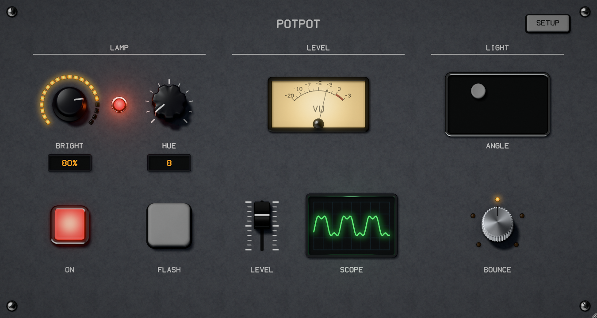

# potpot



Panels for audio plugins built on a [baseview](https://github.com/RustAudio/baseview)
window, drawn live on the GPU as a lit 3D scene. Controls, lamps and lettering are geometry
under one light, so shadows, shine and the spill of a lamp come from the scene.

## Crates

| Crate             | Description                                                                                                  |
| ----------------- | ------------------------------------------------------------------------------------------------------------ |
| `potpot`          | Draws a scene of parts with wgpu and returns the object under a point                                        |
| `potpot-controls` | What a panel's controls do and its displays plot, with no look and no dependencies                           |
| `potpot-window`   | A baseview window for a panel of controls, and an editor for [nice-plug](https://crates.io/crates/nice-plug) |

## Usage

```sh
just demo                    # a window with every kind of part on it
just equalizer               # dots, knobs and faders on the same four bands
just compressor              # a curve to drag, and meters from an audio thread
just synth                   # a wave, a filter and an envelope on screens
just flat                    # a panel drawn with flat shapes alone
just picture out.png synth   # one of potpot's example panels, drawn to a file
```

`just flat` runs on `potpot-controls` and `potpot-window` alone. A panel's look is a `Skin`:

```rust,no_run
use potpot_window::controls::flat::Flat;
use potpot_window::controls::interaction::{Control, Dial, Readout, Target};
use potpot_window::{Gpu, Opening, Param, Settings, Skin, View, wgpu};

// one control, drawn as a bar as long as its value
struct Bar;

impl Skin for Bar {
  fn prepare(&mut self, _: &Gpu, view: &View, over: &mut Flat) {
    over.rect([20.0, 40.0], [20.0 + 160.0 * view.controls[0].value, 60.0], [1.0; 4]);
  }
  fn draw(&self, _: &mut wgpu::CommandEncoder, _: &wgpu::TextureView, _: [u32; 4]) {}
  fn target_at(&self, at: [f32; 2]) -> Option<Target> {
    (40.0..60.0).contains(&at[1]).then_some(Target::Control(0))
  }
}

fn main() -> Result<(), potpot_window::baseview::Error> {
  let settings = Settings::new("Bar", [200.0, 100.0]);
  let params = vec![Param::free(Dial::linear([0.0, 1.0], 0.5, None, 2, ""))];
  let controls = vec![Control::new(0, Readout::new(4))];
  let opened = potpot_window::open(settings, params, controls, Opening::alone(), |_| Bar)?;
  opened.window.run_until_closed()
}
```

`crates/potpot-window/examples/flat.rs` is a whole panel written this way, and
`potpot_window::nice_plug` makes one the editor of a plugin.

## Platform support

The window draws with Vulkan, Direct3D 12 or Metal.

## License

Licensed under either of

- Apache License, Version 2.0 ([LICENSE-APACHE](LICENSE-APACHE) or
  <http://www.apache.org/licenses/LICENSE-2.0>)
- MIT license ([LICENSE-MIT](LICENSE-MIT) or <http://opensource.org/licenses/MIT>)

at your option.

### Contribution

Unless you explicitly state otherwise, any contribution intentionally submitted for inclusion
in the work by you, as defined in the Apache-2.0 license, shall be dual licensed as above,
without any additional terms or conditions.
